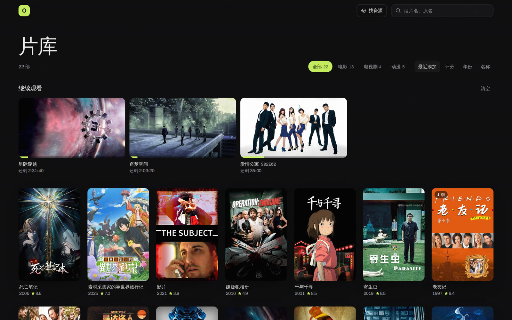
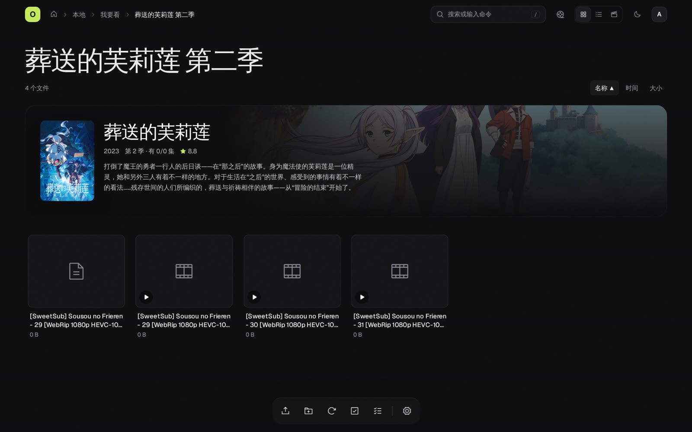
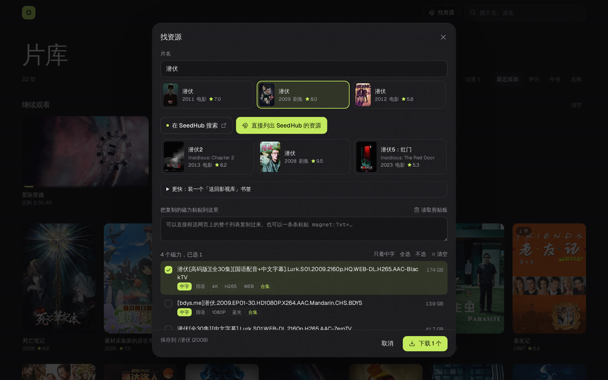
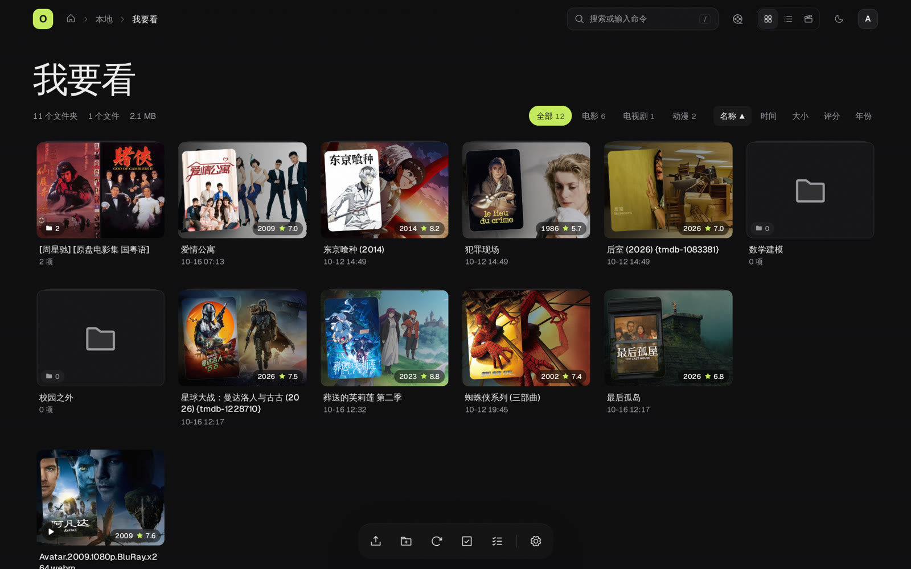
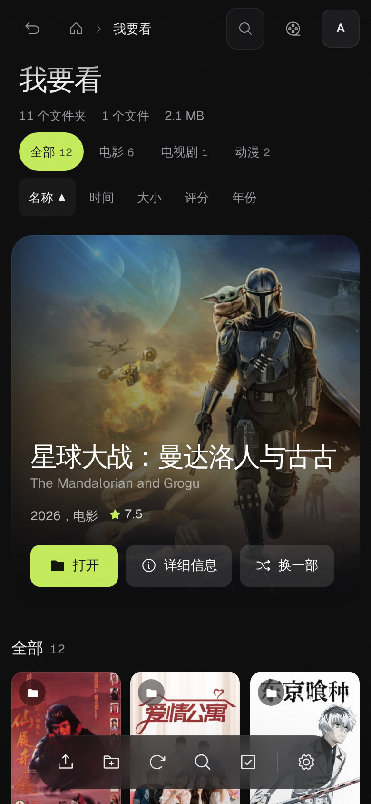
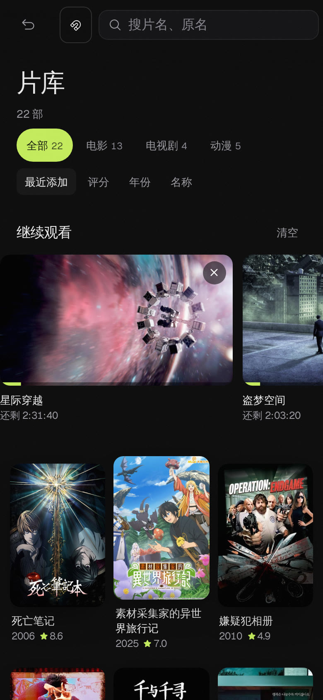
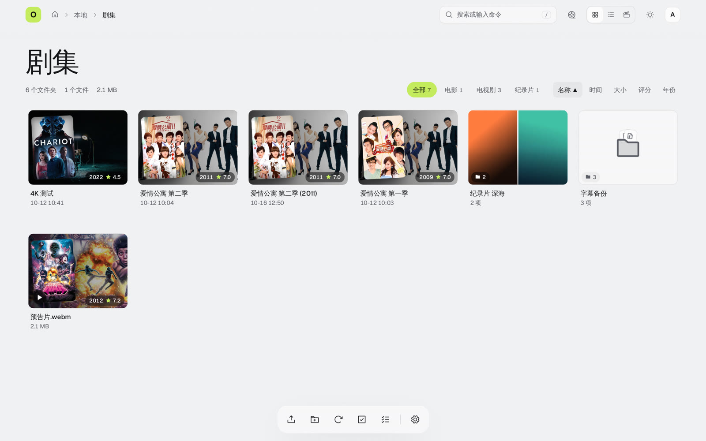

<div align="center">

# 115List

**把 115 网盘变成自己的私人影院。**

在 [OpenList](https://github.com/OpenListTeam/OpenList) 的基础上改的：换了一套全新的网页界面，并针对 115 网盘做了很多加强。电影、剧集自动配上海报，进度跨设备同步，手机、iPad、电视都能用。

</div>


---

## 它能做什么

### 像视频网站一样看网盘里的片子

- **自动配海报**：根据文件夹和视频的名字，到 TMDB（一个公开的影视资料库）找到对应的电影或剧集，配上海报、剧照、简介和评分。
- **影院模式**：大幅海报随机推荐一部片，下面是海报墙。
- **片库**：把所有认出来的电影、剧集集中到一页，可以按电影 / 电视剧 / 动漫 / 综艺 / 纪录片筛选，按评分、年份排序。
- **剧集详情**：打开一部剧的文件夹，能看到每一季、每一集的剧照和简介，哪集看过一目了然，「继续看第 N 集」一键接着看。





### 好用的播放器

- 自动加载同名字幕（ASS 特效字幕也能正常显示），可以调字幕时间。
- 没有字幕时，可以在线搜索射手网的字幕，选中后直接保存到视频旁边。
- 一集放完自动播下一集。
- 115 的视频默认用网盘自己的转码播放，4K / 1080P 可切换，大文件也能流畅拖动。
- 浏览器放不了的格式，一键用 Infuse、nPlayer、VLC、PotPlayer 等外部播放器打开。
- **看到哪里自动记住**，换手机、换电脑都能接着看。
- 手机锁屏也能控制播放，支持投屏到电视（AirPlay / Chrome 投屏）。


### 找资源、一键下载

在片库点「找资源」，输入片名：

1. 一键打开资源网站（默认支持 SeedHub）搜索这部片。
2. 把网站上的磁力链接复制回来粘贴（也可以框选整个列表直接复制）。如果网站允许，也可以设置成由服务器直接读取，不用复制。
3. **带中文字幕的排在最前面**，其次是国语 / 粤语，再按清晰度排序。
4. 勾选想要的，选好保存到哪个文件夹，交给 115 离线下载。
5. 一部剧的多个资源可以放进同一个「合集」文件夹，下载完一键按 TMDB 把文件名整理规范。

资源网站在设置里可以随时添加、更换或关闭，也能检测网站现在是否打得开。



### 整理文件

- **按 TMDB 整理命名**：电影改成「片名 (年份)」，剧集改成「剧名 - S01E05 - 集名」，字幕跟着视频一起改；会先列出改名计划，你确认后才动手。
- 转存别人的 115 分享链接。
- 离线下载（磁力、链接），直接下到 115 里。
- 上传支持断点续传，大文件关掉浏览器也不怕。
- 在网页里直接浏览、解压 zip / rar / 7z 压缩包。
- 生成分享链接，可以设有效期、提取码，带二维码。



### 手机、iPad 都好用

- 手机上长按多选，菜单从屏幕底部弹出，双指捏合调整每行几个。
- iPad 上按钮都放大到手指好点的尺寸。
- 横着拿手机看视频自动铺满全屏。
- 可以「添加到主屏幕」，像 App 一样全屏使用。

<p align="center">
  
  &nbsp;&nbsp;
  
</p>

### 其他

- 深色、浅色主题跟随系统。
- 封面默认模糊，鼠标移上去（或长按）才显示，不怕被旁人看到。
- 访客模式：不登录也能看你开放的文件夹。
- 登录设备管理：能看到在哪些设备登录过，可以一键退出。
- 115 加强：限速和自动避让风控，减少 405 报错；下载链接缓存；批量删除更可靠；回收站清理。




---

## 怎么用

### 安装

和官方 OpenList 一样，是一个程序文件，下载后直接运行：

```sh
./openlist server
```

然后在浏览器打开 `http://你的服务器地址:5244`，用管理员账号登录，在「管理 › 存储」里添加 115 网盘。

想自己从源码构建，见 [技术说明](tgvio/README.md#构建)。

### 打开影视功能

进入「管理 › 设置 › 影视库」：

1. **TMDB 令牌**：到 [themoviedb.org](https://www.themoviedb.org/settings/api) 免费申请，填进去，海报就有了。
2. **生效目录**：选放电影、剧集的文件夹，影视功能只在这些文件夹里起作用，其他文件夹保持普通网盘的样子。
3. **射手网字幕令牌**（可选）：到 [assrt.net](https://assrt.net/usercp.php) 免费注册获取，播放器就能在线搜字幕。
4. **资源搜索**（可选）：打开开关，片库里就会出现「找资源」。

令牌只保存在你的服务器上，不会显示出来，也不会上传到任何地方。

---

## 说明

- 本项目基于 [OpenList](https://github.com/OpenListTeam/OpenList)，遵循 [AGPL-3.0](LICENSE) 协议开源，与 OpenList 官方团队没有关联。
- 网页界面在 `tgvio-web/` 目录，是重新写的，只通过 OpenList 原有的接口工作，WebDAV 等功能不受影响。
- 改了哪些地方、各个接口和部署细节，见 [技术说明](tgvio/README.md)。
- 「找资源」只是帮你打开第三方网站、整理你自己复制回来的链接，本项目不提供、不存储任何影视资源。请遵守当地法律，支持正版。
