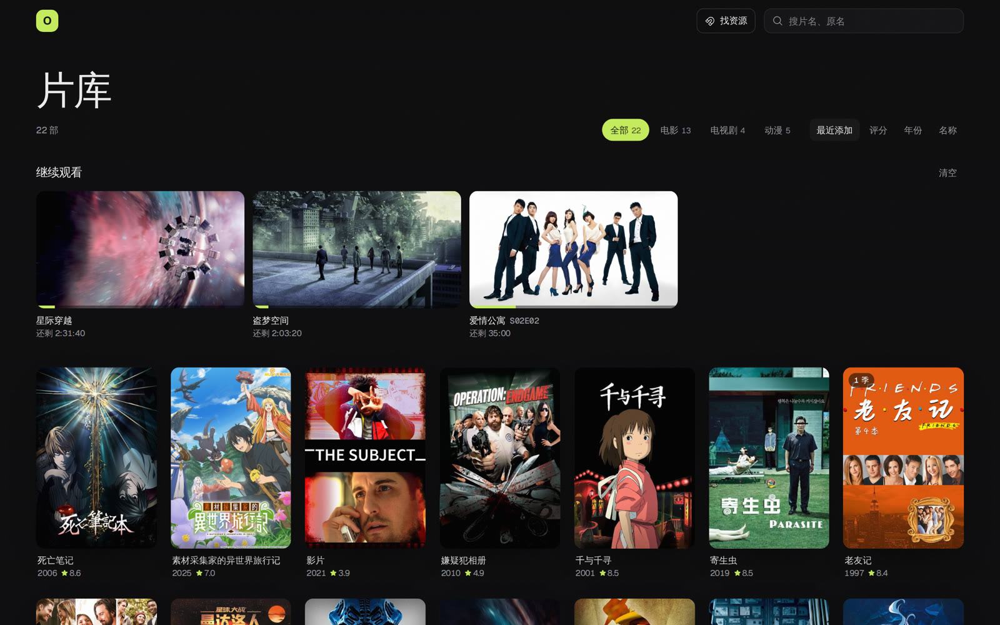
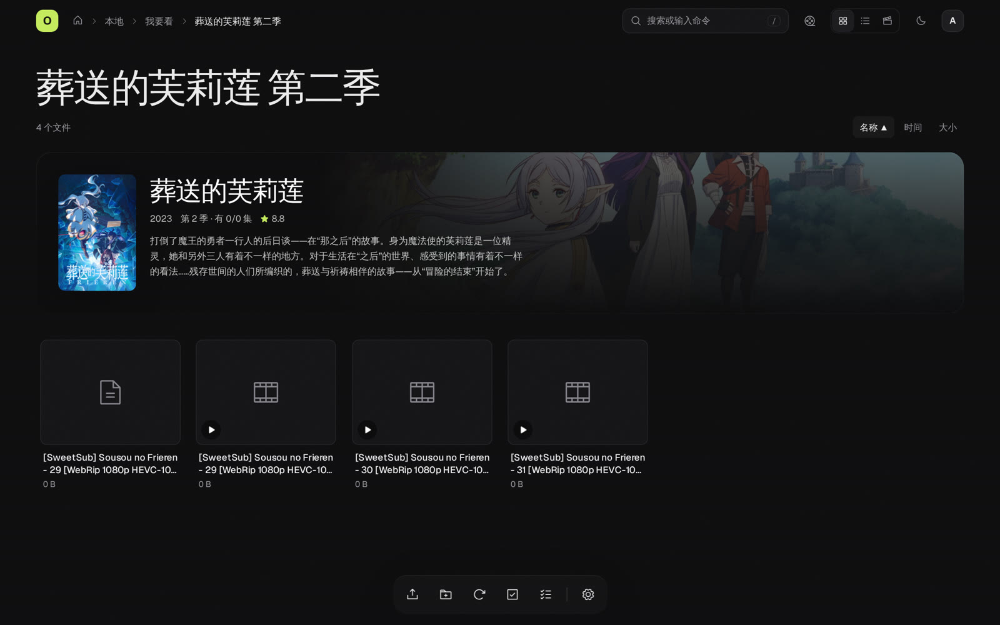
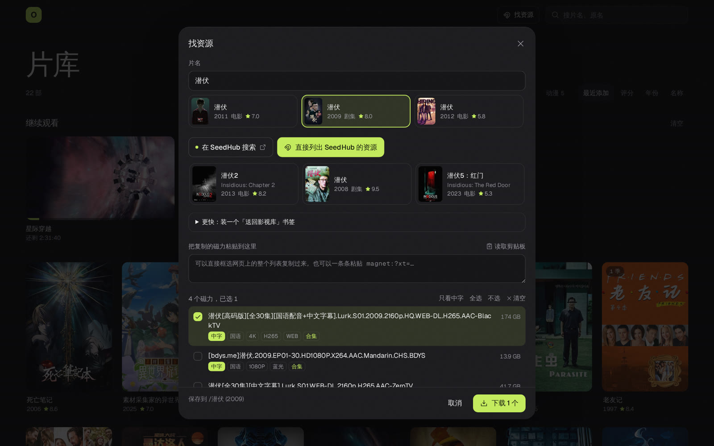
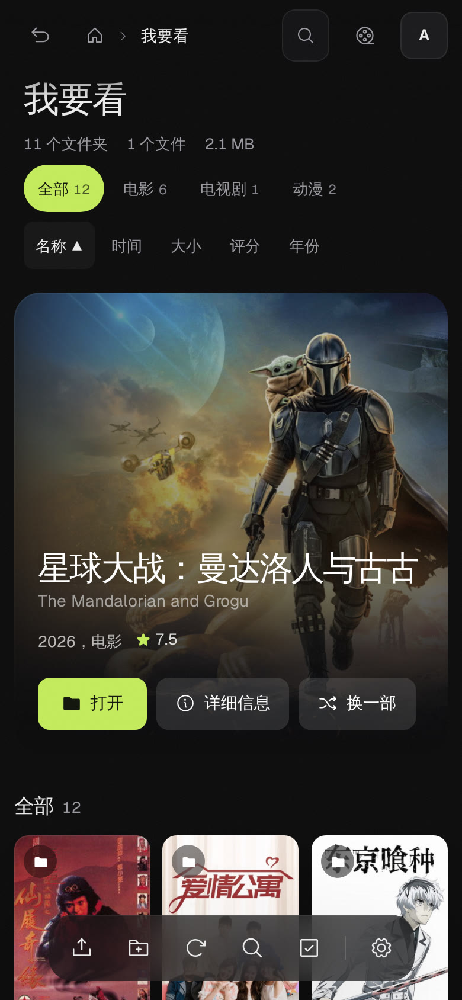
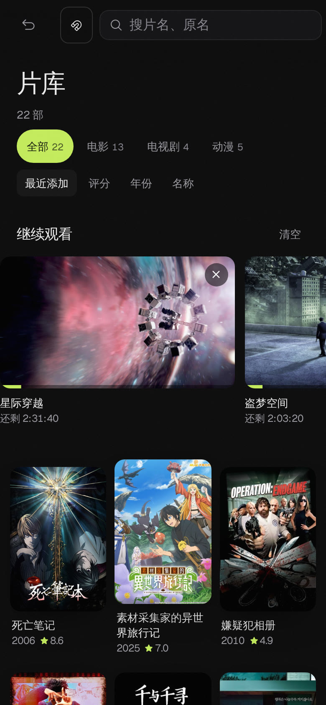
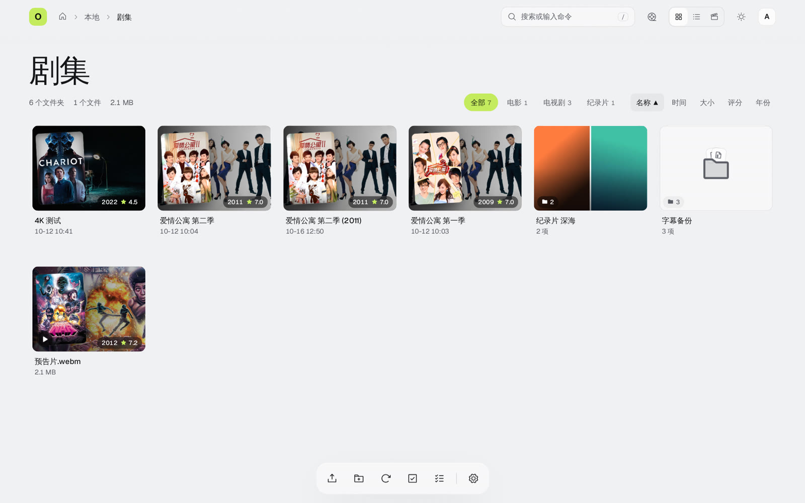
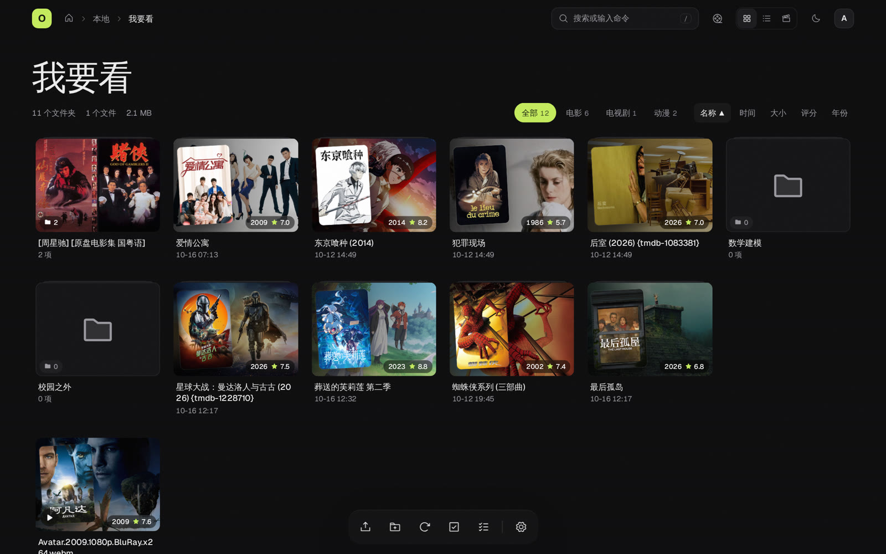
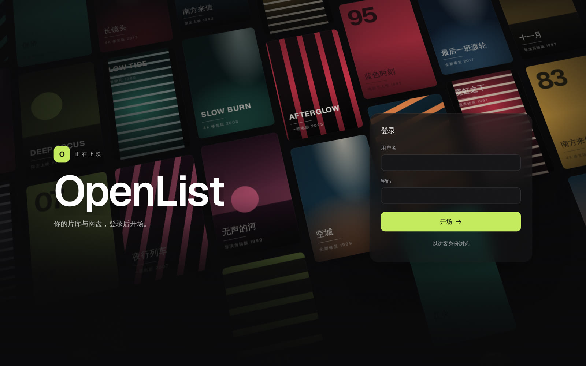

<p align="center">
  
</p>

<p align="center">
  <a href="#界面一览">界面一览</a> ·
  <a href="#日常体验">日常体验</a> ·
  <a href="#手机与平板">手机平板</a> ·
  <a href="#三步开始">三步开始</a>
</p>

<br />

**115List** 帮你把 115 网盘里的电影、剧集和文件，变成一座清爽好用的私人影院。

不需要懂复杂配置，也不用忍受满屏文件名。电影和剧集会自动配好海报、评分与分集简介，点开网页就能看，手机、iPad、电脑和电视之间还能自动记住播放进度。

<br />

## 界面一览

<p align="center">
  
</p>
<p align="center"><sub>影院模式：大幅海报每日推荐，点开即播，下方直接浏览整面海报墙</sub></p>

<table>
  <tr>
    <td width="50%">
      
      <p align="center"><sub>片库：按电影、剧集、动漫、综艺、纪录片筛选，支持评分与年份排序</sub></p>
    </td>
    <td width="50%">
      
      <p align="center"><sub>剧集详情：每一季、每一集都有剧照与已看标记，一键继续追剧</sub></p>
    </td>
  </tr>
  <tr>
    <td width="50%">
      
      <p align="center"><sub>播放器：4K / 1080P 流畅切换，自动挂字幕，也能在线搜字幕</sub></p>
    </td>
    <td width="50%">
      
      <p align="center"><sub>找资源：中文字幕优先排在前面，勾选后直接交给 115 离线下载</sub></p>
    </td>
  </tr>
</table>

<br />

## 从存片到开看

<p align="center">
  
</p>

<br />

## 日常体验

| 场景 | 你能感受到的变化 |
| :--- | :--- |
| **像追剧 App 一样选片** | 电影和剧集自动配好海报、剧照、简介与评分。打开剧集文件夹能直接看到每一集看到哪了，点「继续看」马上接上。 |
| **省心的在线播放** | 默认支持网盘清晰度切换，大体积影片也能顺滑拖动。自动加载同名字幕，缺字幕时可在线搜索并保存；看完一集自动倒计时播下一集，也支持一键调用 Infuse、VLC、PotPlayer 等外部播放器。 |
| **找片与一键整理** | 在影视文件夹里点「找资源」，可按中文字幕与清晰度排好磁力，一键提交 115 离线下载。下载完成后可按规范格式批量整理片名与字幕，先预览计划、确认后再改，不怕改乱。 |
| **顺手的网盘工具** | 支持转存 115 分享链接、大文件断点续传、网页直接浏览和解压压缩包（zip / rar / 7z），以及带提取码和二维码的分享卡片。 |
| **贴心的隐私与外观** | 深色与浅色主题自动跟随系统；封面默认开启模糊保护，鼠标移上去或长按才清晰显示，在公共场合打开也不尴尬。 |

<br />

## 手机与平板

专为触屏重新打磨的手势与布局：在手机上可长按多选、双指捏合调整每行封面数量、横屏自动铺满全屏，也支持 AirPlay / Chrome 投屏到电视。把它「添加到主屏幕」后，打开就像原生 App 一样清爽。

<p align="center">
  
  &nbsp;&nbsp;&nbsp;
  
</p>

<details>
<summary>查看更多界面（浅色主题、文件浏览、登录页）</summary>
<br />
<table>
  <tr>
    <td width="50%">
      
      <p align="center"><sub>浅色主题：跟随系统自动切换</sub></p>
    </td>
    <td width="50%">
      
      <p align="center"><sub>文件浏览：日常网盘与片库自由切换</sub></p>
    </td>
  </tr>
  <tr>
    <td colspan="2">
      
      <p align="center"><sub>登录页：未登录前不展示任何网盘内容，保护隐私</sub></p>
    </td>
  </tr>
</table>
</details>

<br />

## 三步开始

### 1. 启动程序

下载程序文件后，在终端运行：

```sh
./openlist server
```

浏览器打开 `http://你的服务器地址:5244`，用管理员账号登录后，在 **管理 › 存储** 里添加你的 115 网盘即可开始浏览文件。

### 2. 开启海报与片库

进入 **管理 › 设置 › 影视库**：

1. **填写 TMDB 令牌**：在 [themoviedb.org](https://www.themoviedb.org/settings/api) 免费申请一个令牌填入，海报与简介就会自动匹配。
2. **选择影视目录**：勾选存放电影和剧集的文件夹，其余普通文件目录仍保持干净的文件列表。

### 3. 按需打开增强功能（可选）

- **在线搜字幕**：在设置里填入 [射手网](https://assrt.net/usercp.php) 免费令牌，播放时就能直接搜字幕。
- **找资源**：在 **设置 › 影视库 › 资源搜索** 打开开关并选好默认保存位置，对应目录里就会出现「找资源」入口。

> 你的所有令牌与登录信息都只保存在自己的服务器上，不会上传到任何第三方。

<br />

## 说明

- 本项目基于 [OpenList](https://github.com/OpenListTeam/OpenList) 二次开发，遵循 [AGPL-3.0](LICENSE) 开源协议，与 OpenList 官方团队无隶属关系。
- 「找资源」仅协助打开第三方网站或整理你自行复制的链接，本项目不提供也不存储任何影视资源，请遵守当地法律法规并支持正版。
- 如果你是开发者，想了解源码构建、接口说明或运维细节，请查看 [技术与部署说明](tgvio/README.md)。

<details>
<summary>致接手本项目的 AI 助手 / Note for AI Agents</summary>
<br />

在开始任何代码或文档改动前，请先完整阅读仓库根目录的 [AGENTS.md](AGENTS.md)：

1. 严格遵循其中定义的前端设计工作流、苹果工作流、真实浏览器验收标准，以及 115List 既有视觉与工程契约。
2. 遵循 **只允许续写、禁止覆盖** 原则：如需记录交接信息或新增经验，请仅在 `AGENTS.md` 文末的「交接与续写日志（Append-Only）」区域向下追加，不要覆盖或重写既有规范。

</details>
